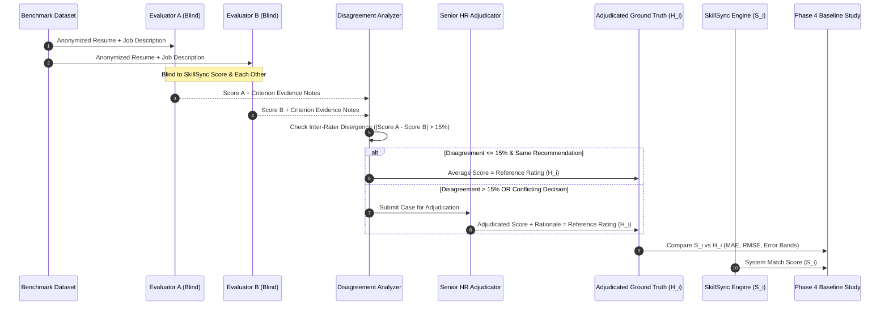

# SkillSync HR Benchmark & Baseline Evaluation Protocol

**Version:** 1.0.0 (Phase 3 Benchmark Protocol)  
**Status:** Approved for Implementation & Baseline Study  
**Document Owner:** SkillSync Evaluation & Talent Science Working Group  

---

## 1. Overview & Objectives

This protocol defines the operational process for collecting independent, double-blind human HR evaluations of candidate resumes against job requisitions, adjudicating evaluator disagreements, and benchmarking SkillSync's algorithmic match scores ($S_i$) against authoritative human reference ratings ($H_i$).



---

## 2. Double-Blind Human Evaluation Workflow

### 2.1 Evaluator Selection & Training
1. **Qualifications**: Evaluators must possess a minimum of 2 years of professional technical recruiting, talent acquisition, or hiring management experience.
2. **Calibration Training**: Before evaluating production benchmark cases, all evaluators must complete a calibration session assessing 5 synthetic reference cases with the standardized rubric until inter-rater variance is under 10%.
3. **Double-Blind Isolation**:
   - Evaluators must **never** see SkillSync's calculated match percentage ($S_i$) or any internal sub-scores before or during evaluation.
   - Evaluators assess the resume independently and cannot see the other evaluator's scores or comments until both have formally submitted.

### 2.2 Evaluation Process
For each benchmark case:
1. Review the full job requisition (title, mandatory requirements, preferred qualifications, responsibilities).
2. Review the anonymized candidate resume.
3. For each of the 6 rubric criteria (`REQ_SKILLS`, `EXP_RELEVANCE`, `EVIDENCE_ACHIEVE`, `TRANS_SKILLS`, `EDU_QUAL`, `CERTS_CRED`):
   - Assign a score from 0 to 4 using the rubric anchors.
   - Cite specific documentary evidence from the resume (or cite `"UNMENTIONED"` / `"INSUFFICIENT_EVIDENCE"`).
   - Set confidence level (`HIGH`, `MEDIUM`, `LOW_EVIDENCE`).
4. Assign an overall recommendation: `STRONG_MATCH`, `ACCEPTABLE_MATCH`, `BORDERLINE`, or `REJECT`.
5. Provide a 2–3 sentence executive summary explaining the assessment.

---

## 3. Disagreement Resolution & Adjudication Protocol

### 3.1 Inter-Rater Agreement & Divergence Triggers
Let $R_1$ and $R_2$ be the overall fit percentages submitted by Evaluator 1 and Evaluator 2.

A case is automatically flagged for **Senior HR Adjudication** if:
1. **Score Divergence**: $|R_1 - R_2| > 15.0$ percentage points.
2. **Decision Divergence**: The two evaluators produce conflicting binary recommendations (e.g., one recommends `ACCEPTABLE_MATCH` or `STRONG_MATCH`, while the other recommends `REJECT`).
3. **Mandatory Gating Disagreement**: One evaluator identifies a mandatory qualification as `DEMONSTRABLY_LACKING` while the other marks it as `MEETS` or `EXCEEDS`.

### 3.2 Consensus Cases ($|R_1 - R_2| \le 15\%$ and aligned recommendation)
When scores are in close agreement and recommendations align, the binding ground truth reference score $H_i$ is computed as the arithmetic mean:
$$H_i = \frac{R_1 + R_2}{2}$$

### 3.3 Adjudication Procedure
When triggered:
1. A designated **Senior HR Adjudicator** receives the case with both evaluator scorecards, cited textual evidence, and summary notes.
2. The adjudicator reviews the disputed criteria against the resume text.
3. The adjudicator submits a binding, adjudicated score $H_i$, accompanied by an `adjudication_rationale` explaining which evidence supported the final rating.

---

## 4. Benchmark Dataset Structure & Schema Specifications

The benchmark dataset consists of structured JSON records following this strict specification:

```typescript
interface BenchmarkCase {
  case_id: string;               // e.g., "BENCH-SWE-001"
  provenance: {
    source_type: "synthetic_fixture" | "authorized_candidate_case";
    license_or_consent: string;   // e.g., "CC0-Synthetic" or "Candidate-Consent-Signed"
    created_at: string;          // ISO 8601
    anonymized_by?: string;
  };
  validation_split: "CALIBRATION" | "HELD_OUT_VALIDATION";
  job_posting: {
    job_id: string;
    title: string;
    department: string;
    job_category: "Frontend" | "Backend" | "Fullstack" | "DevOps" | "Data" | "Mobile" | "General";
    seniority_level: "ENTRY" | "JUNIOR" | "MID" | "SENIOR" | "LEAD";
    mandatory_requirements: string[];
    preferred_qualifications: string[];
    description_text: string;
  };
  candidate_profile_anonymized: {
    profile_id: string;
    target_role: string;
    seniority_level: string;
    education: {
      degree: string | null;
      field: string | null;
      institution_type: string | null;
    };
    years_of_experience: number;
    extracted_skills: string[];
    anonymized_resume_text: string;
  };
  evaluations: Array<{
    evaluator_id: string;
    criteria_scores: {
      REQ_SKILLS: number;       // 0-4
      EXP_RELEVANCE: number;    // 0-4
      EVIDENCE_ACHIEVE: number; // 0-4
      TRANS_SKILLS: number;     // 0-4
      EDU_QUAL: number;         // 0-4
      CERTS_CRED: number;       // 0-4
    };
    criteria_evidence: Record<string, string>;
    overall_fit_percentage: number; // 0-100
    recommendation: "STRONG_MATCH" | "ACCEPTABLE_MATCH" | "BORDERLINE" | "REJECT";
    confidence: "HIGH" | "MEDIUM" | "LOW_EVIDENCE";
    notes: string;
  }>;
  adjudication: {
    is_adjudicated: boolean;
    adjudicator_id: string | null;
    reference_score: number;    // Authoritative H_i (0-100)
    adjudication_rationale: string | null;
  };
  system_baseline?: {
    skillsync_score: number | null; // S_i computed in Phase 4
    evaluated_at?: string;
  };
}
```

### 4.1 Strict Exclusion of PII & Synthetic Segregation
- **PII Scrubbing**: Real candidate names, email addresses, phone numbers, street addresses, and identifiable social URLs must be scrubbed before insertion.
- **Explicit Tagging**: All synthetic test fixtures must be explicitly tagged `source_type: "synthetic_fixture"`. Synthetic records are never intermingled or presented as human ground truth.

---

## 5. Phase 4 Baseline Evaluation Methodology

Phase 4 will assess how closely SkillSync's current match scores agree with the adjudicated HR reference scores ($H_i$).

### 5.1 Primary Evaluation Metrics

1. **Mean Absolute Error (MAE)**:
   $$\mathrm{MAE} = \frac{1}{n} \sum_{i=1}^{n} |S_i - H_i|$$
   - Measures average magnitude of error in percentage points.
   - Target benchmark: $\mathrm{MAE} \le 12.0\%$.

2. **Root Mean Squared Error (RMSE)**:
   $$\mathrm{RMSE} = \sqrt{\frac{1}{n} \sum_{i=1}^{n} (S_i - H_i)^2}$$
   - Penalizes large individual outliers more heavily than MAE.

3. **Threshold Agreement Bands**:
   - $\mathrm{Acc}_{\pm 5\%}$: Percentage of cases where $|S_i - H_i| \le 5\%$.
   - $\mathrm{Acc}_{\pm 10\%}$: Percentage of cases where $|S_i - H_i| \le 10\%$.
   - $\mathrm{Acc}_{\pm 15\%}$: Percentage of cases where $|S_i - H_i| \le 15\%$ (Target $\ge 70\%$).

4. **Inter-Rater Reliability (IRR)**:
   - Evaluator Agreement MAE: $\frac{1}{n} \sum |R_{1,i} - R_{2,i}|$.
   - Intraclass Correlation Coefficient (ICC(2,1)) to assess consistency between raters across cases.

### 5.2 Leakage Prevention Between Splits
- **Calibration Split (60%)**: Used in Phase 5 to analyze error modes, test weight adjustments, and experiment with scoring rules.
- **Held-Out Validation Split (40%)**: Strictly reserved to validate the final model.
- **Candidate-Level Isolation Rule**: If a candidate has multiple applications or resume variants, **all** instances of that candidate must be assigned strictly to either `CALIBRATION` or `HELD_OUT_VALIDATION`. Overlapping candidate IDs across splits is prohibited and enforced by automated tests.

---

## 6. Pilot Roadmap to Real Data Collection

| Phase Step | Objective | Target Volume | Target Timeline |
| :--- | :--- | :--- | :--- |
| **Phase 3 Pilot (Current)** | Test schemas, rubric math, adjudication logic, and baseline scripts using synthetic fixtures. | 10 Synthetic Cases | Immediate (Phase 3) |
| **Stage 1 HR Pilot** | Collect initial dual-rated real cases across 3 key disciplines (Frontend, Backend, DevOps). | 30 Real Cases | Post-Phase 3 Handover |
| **Stage 2 Expansion** | Expand evaluation across Seniority tiers (Entry to Lead) and non-engineering roles. | 120 Real Cases | Prior to Phase 5 Calibration |
