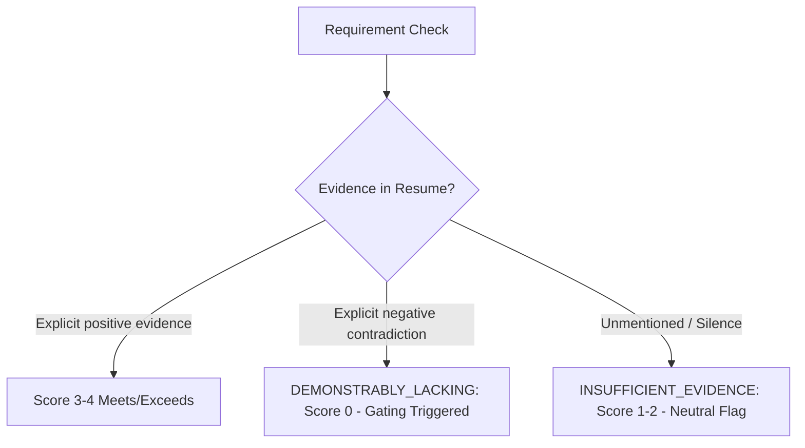

# SkillSync HR Evaluation Rubric: Standardized Candidate-Job Assessment

**Version:** 1.0.0 (Phase 3 Benchmark Standard)  
**Status:** Approved for Calibration & Benchmark Evaluation  
**Author:** SkillSync Talent Science & Evaluation Working Group  

---

## 1. Purpose & Guiding Principles

The objective of this rubric is to provide a standardized, objective, and defensible evaluation framework for human recruiters and hiring managers to assess a candidate's resume against a specific job specification.

### Core Principles:
1. **Evidence-Based Grounding**: Every rating must be grounded in explicit documentary evidence found in the candidate's resume (titles, dates, quantifiable achievements, tool stacks, responsibilities).
2. **Independence from Algorithmic Weights**: The rubric is designed independently from SkillSync's internal algorithmic weights. It serves as an external, authoritative ground truth reference ($H_i$) against which the algorithm ($S_i$) is calibrated.
3. **Absence of Evidence $\neq$ Evidence of Absence**: If a resume does not mention a preferred qualification or secondary tool, evaluators must record `INSUFFICIENT_EVIDENCE` or `UNSPECIFIED` rather than assuming deliberate incompetence or failure.
4. **Mandatory vs. Preferred Separation**: Mandatory requirements represent non-negotiable minimum qualifications. Preferred qualifications represent differentiating competencies.

---

## 2. Evaluation Criteria Matrix

The rubric assesses candidate suitability across **six core dimensions**:

| Criterion Key | Dimension | Description | Standard Weight |
| :--- | :--- | :--- | :---: |
| `REQ_SKILLS` | **Required Skills & Core Competencies** | Mastery of core technical or domain skills explicitly designated as mandatory by the job specification. | **30%** |
| `EXP_RELEVANCE` | **Relevant Work Experience** | Duration, seniority, domain alignment, and operational scale of prior employment roles. | **25%** |
| `EVIDENCE_ACHIEVE` | **Job-Related Evidence & Achievements** | Concrete accomplishments, production outcomes, metrics, architectural deliveries, or portfolio links. | **15%** |
| `TRANS_SKILLS` | **Transferable Skills & Problem Solving** | Adjacent frameworks, related programming languages, foundational problem solving, analytical acumen, agility. | **15%** |
| `EDU_QUAL` | **Education & Qualifications** | Relevant degrees, accredited coursework, bootcamps, or equivalent industry background. | **10%** |
| `CERTS_CRED` | **Certifications & Credentials** | Professional licenses, cloud/security certifications, or accredited domain badges. | **5%** |

*Note: For roles where certifications are mandatory (e.g., Nursing, Bar Admission, CPA, Flight Operations), weights shift to enforce licensing gating as described in Section 4.*

---

## 3. Standardized 5-Level Scoring Anchors

Each criterion is evaluated on a discrete 0–4 scale with defined behavioral anchors:

### 3.1 Criterion 1: Required Skills (`REQ_SKILLS`)
- **4 — Exceeds Requirement**: Demonstrates advanced depth in all required skills, with extensive production usage, architecture leadership, or mentorship experience.
- **3 — Fully Meets Requirement**: Demonstrates proficiency in all required skills with clear evidence of sustained practical application in commercial or open-source projects.
- **2 — Partially Meets Requirement**: Demonstrates proficiency in a majority of required skills, but has noticeable gaps in one or two secondary required tools.
- **1 — Minimally Meets Requirement**: Mentions only 1 or 2 required skills with superficial or keyword-only evidence; lacks practical context.
- **0 — No Evidence / Does Not Meet**: None of the required skills are mentioned or demonstrated in the resume text.

### 3.2 Criterion 2: Relevant Work Experience (`EXP_RELEVANCE`)
- **4 — Exceeds Requirement**: Exceeds the required years of experience in an identical or more senior capacity, within an equivalent or larger operational scale.
- **3 — Fully Meets Requirement**: Meets the required years of experience in directly relevant roles with commensurate scope of responsibility.
- **2 — Partially Meets Requirement**: Has adjacent or somewhat related experience, or slightly under the target years (e.g., 2.5 years when 3–5 years are requested).
- **1 — Minimally Meets Requirement**: Substantially under-experienced (e.g., < 1 year for a mid-level role) or experience is in an unrelated domain with little operational overlap.
- **0 — No Evidence**: No professional experience documented, or entire history is wholly unrelated.

### 3.3 Criterion 3: Evidence & Achievements (`EVIDENCE_ACHIEVE`)
- **4 — Exceeds Requirement**: High-impact quantified outcomes throughout (e.g., *"reduced latency by 42%, handled 10M daily requests, led migration of 14 microservices"*).
- **3 — Fully Meets Requirement**: Multiple documented accomplishments with specific deliverables, outcomes, and business impact.
- **2 — Partially Meets Requirement**: Describes job responsibilities and daily tasks, but provides few quantifiable metrics or distinct achievements.
- **1 — Minimally Meets Requirement**: Vague, high-level task lists without clear project deliverables or verifiable outcomes.
- **0 — No Evidence**: Mere lists of job titles and company names with no descriptive bullet points.

### 3.4 Criterion 4: Transferable Skills & Problem Solving (`TRANS_SKILLS`)
- **4 — Exceeds Requirement**: Broad cross-stack versatility (e.g., polyglot fluency, cross-functional project leadership, complex system debugging, open-source maintainer).
- **3 — Fully Meets Requirement**: Strong adjacent skills that facilitate rapid ramp-up (e.g., Python expert transitioning to Go; deep relational database knowledge transitioning to PostgreSQL).
- **2 — Partially Meets Requirement**: Some foundational skills present, but narrow scope requires standard training/onboarding.
- **1 — Minimally Meets Requirement**: Limited versatility; skills appear isolated to a single proprietary or legacy tool.
- **0 — No Evidence**: No evidence of analytical, architectural, or transferable capabilities.

### 3.5 Criterion 5: Education & Relevant Qualifications (`EDU_QUAL`)
- **4 — Exceeds Requirement**: Advanced relevant degree (e.g., Master's/Ph.D. in CS/Data Science) or specialized academic honors/research.
- **3 — Fully Meets Requirement**: Holds the degree or formal qualification requested by the job specification (or demonstrates 4+ years of equivalent professional mastery).
- **2 — Partially Meets Requirement**: Holds a degree in an adjacent discipline (e.g., Electrical Engineering, Mathematics, Physics for Software Engineering) or completed an accredited intensive technical program.
- **1 — Minimally Meets Requirement**: Incomplete degree, unrelated field without technical coursework, or self-directed study with early portfolio.
- **0 — No Evidence**: No education or training documented.

### 3.6 Criterion 6: Certifications & Credentials (`CERTS_CRED`)
- **4 — Exceeds Requirement**: Holds premier tier credentials (e.g., AWS Solutions Architect Professional, CKA, CISSP) directly aligned with role.
- **3 — Fully Meets Requirement**: Holds requested certifications (e.g., AWS Associate, Scrum Master, CCNA) or active professional license.
- **2 — Partially Meets Requirement**: Holds introductory or related certifications (e.g., Cloud Practitioner, CompTIA A+).
- **1 — Minimally Meets Requirement**: Expired certification or certification currently in progress.
- **0 — No Evidence**: No certifications listed (standard score if certifications are optional).

---

## 4. Mandatory Gating vs. Preferred Weighting

### 4.1 Mandatory Qualification Gating
If a job description explicitly designates a requirement as **MANDATORY** (e.g., *"Must have active CPA license"*, *"Must possess at least 3 years of hands-on Java development"*, *"Must hold valid Driver's License"*):
- If the candidate **demonstrably lacks** the mandatory requirement, the maximum overall reference score ($H_i$) is **capped at 35%**, and the recommendation must be `REJECT`.
- If the candidate's resume provides **insufficient evidence** to confirm the mandatory requirement (unmentioned), the score is capped at **50%** pending clarification, and flagged with `UNVERIFIED_MANDATORY`.

### 4.2 Preferred Qualifications
Preferred qualifications (e.g., *"Experience with GraphQL is a plus"*, *"Docker familiarity preferred"*) cannot penalize a candidate below a passing score if not met. Their presence awards incremental points within `TRANS_SKILLS` and `REQ_SKILLS`, but their absence is not penalized.

---

## 5. Handling Missing, Ambiguous, and Negated Evidence

Evaluators must categorize non-matches into two distinct classes:

1. **`DEMONSTRABLY_LACKING`**:
   - The document affirmatively contradicts the requirement.
   - Example: Job mandates 5 years experience; resume lists candidate's first job starting 8 months ago.
   - Result: Hard deduction; gates mandatory criteria.
2. **`INSUFFICIENT_EVIDENCE` / `UNSPECIFIED`**:
   - The document simply omits mention of the topic.
   - Example: Job prefers Kubernetes; resume details extensive Docker, AWS ECS, and Linux experience, but does not mention Kubernetes.
   - Result: Rated 1 or 2 with `confidence: "LOW_EVIDENCE"`. Does not trigger automatic failure.

---

## 6. Overall Fit Calculation Formula

The normalized HR Overall Fit Score ($H_i$) is calculated from the criterion scores ($C_k \in [0, 4]$) and weights ($W_k$):

$$H_i = \left( \sum_{k=1}^{6} \frac{C_k}{4} \times W_k \right) \times 100\%$$

Subject to mandatory gating rules:
- If any mandatory requirement fails with `DEMONSTRABLY_LACKING`, $H_i = \min(H_i, 35\%)$.
- If any mandatory requirement has `INSUFFICIENT_EVIDENCE`, $H_i = \min(H_i, 50\%)$.

### Standard Recommendation Thresholds:
- **`STRONG_MATCH`**: $H_i \ge 85\%$ (All mandatory met, deep skills, verified accomplishments)
- **`ACCEPTABLE_MATCH`**: $70\% \le H_i < 85\%$ (All mandatory met, minor gaps in secondary preferences)
- **`BORDERLINE`**: $55\% \le H_i < 70\%$ (Viable with training, or non-critical experience shortfall)
- **`REJECT`**: $H_i < 55\%$ (Significant skill deficiency or failed mandatory requirement)
