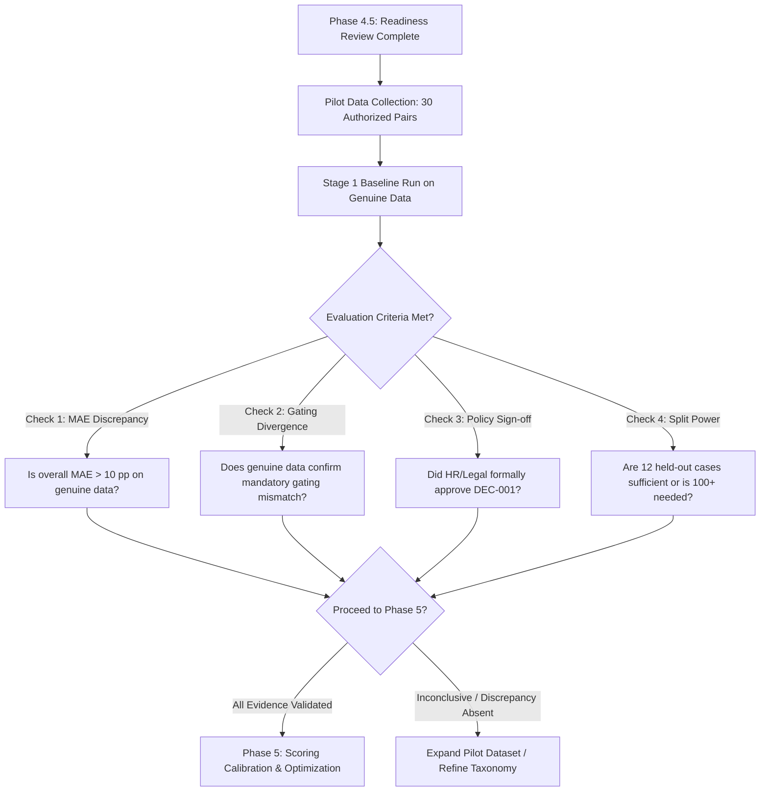

# SkillSync HR Pilot Execution Readiness Review

**Document Identifier:** DOC-2026-HR-PILOT-READY  
**Status:** READY FOR PILOT RECRUITMENT & APPROVAL SIGN-OFF  
**Current Branch:** `feature/mandatory-gating-hr-pilot-prep`  
**Base Commit:** `92ae87e`  
**Target Pilot Scope:** 30 Genuine, Double-Blind Rated Resume-Job Pairs  
**Target Disciplines:** Frontend Engineering, Backend Engineering, Cloud DevOps / SRE  

---

## 1. Executive Summary & Readiness Assessment

The evaluation infrastructure, validation schemas, data-entry templates, qualification state evaluators, and regression harnesses for SkillSync's HR evaluation pilot are **100% complete, verified, and operational**.

### Current Repository State:
- **Evaluation Infrastructure**: Validated by 48 automated test assertions in [`tests/mandatoryGatingAndPilot.test.mjs`](file:///d:/SkillSync/tests/mandatoryGatingAndPilot.test.mjs) and 195+ total test assertions across the entire test suite.
- **Production Safety**: Zero database migrations applied, zero production schema changes, live matching engine [`matchingEngine.js`](file:///d:/SkillSync/src/services/matching/matchingEngine.js) and database RPC `compute_and_save_job_match` remain completely untouched.
- **Data Reality**: The repository currently holds **0 genuine HR benchmark records** and **10 synthetic test fixtures** quarantined strictly for software regression testing (`source: "synthetic_fixture"`).
- **Readiness Verdict**: **The technical harness is ready for pilot data collection.** Pilot execution can begin as soon as HR evaluators are onboarded and the unresolved approval decisions below are signed off.

---

## 2. Unresolved Approval Decisions Requiring HR & Legal Sign-Off

Before live candidate screening rules or scoring adjustments are deployed to production, the following governance decisions must be formally resolved:

| Decision ID | Policy Area | The Question | Option A | Option B (Recommended) | Approval Stakeholder |
| :--- | :--- | :--- | :--- | :--- | :--- |
| **DEC-001** | **Score Capping vs. Conceptual Decoupling** | When a candidate fails an explicit mandatory requirement (`NOT_MET`), should SkillSync cap the numerical Job-Fit Score at $\le 35\%$ or keep the Job-Fit Score honest while disqualifying via Mandatory Eligibility? | **Score Capping ($\le 35\%$):** Overwrites match percentage into `Skills Gap`. | **3-Output Decoupling:** Keeps Job-Fit Score continuous (e.g. $82\%$), sets Eligibility to `INELIGIBLE`, and sets Application Decision to `DISQUALIFIED`. | Head of Talent Science, Legal Counsel |
| **DEC-002** | **Mandatory Designation Governance** | What criteria must a hiring manager meet to flag a skill as `MANDATORY` rather than `PREFERRED`? | Manager discretion (informal checkboxes). | **Strict BFOQ / Statutory Mandate:** Only legal licenses, regulatory clearances, or validated core technologies. | HR Operations, Employment Legal |
| **DEC-003** | **Unverified (`UNKNOWN`) Candidate Workflow** | When a resume omits mention of a mandatory requirement, what is the default candidate pathway? | Auto-rejection after 72 hours. | **Self-Attestation & HR Queue:** Profile flagged `PENDING_VERIFICATION`; candidate prompted to upload proof; recruiter reviews in queue. | HR Screening Lead, UX Lead |
| **DEC-004** | **Adjudication Escalation Threshold** | What inter-rater divergence triggers mandatory senior adjudication? | Simple majority average with no adjudication. | **$\Delta > 15\%$ or State Conflict:** Any score divergence $> 15$ pp or `MET` vs `NOT_MET` conflict triggers Senior Adjudicator. | Lead Benchmark Coordinator |

---

## 3. Comprehensive HR Pilot Readiness Checklist

### Phase 1: Recruiter Onboarding & Calibration
- [ ] **Roster Recruitment**: Confirm pool of at least 4 independent senior technical recruiters (minimum 2 years technical screening experience).
- [ ] **Rubric Training**: Distribute [`docs/hr-evaluation-rubric.md`](file:///d:/SkillSync/docs/hr-evaluation-rubric.md) covering the 6 weighted criteria:
  - Required Skills ($30\%$)
  - Relevant Work Experience ($25\%$)
  - Quantified Evidence & Accomplishments ($15\%$)
  - Transferable Skills & Stack Agility ($15\%$)
  - Education & Academic Qualifications ($10\%$)
  - Certifications & Credentials ($5\%$)
- [ ] **Synthetic Practice Calibration**: Each recruiter independently completes 2 synthetic practice cases.
- [ ] **Inter-Rater Alignment**: Recruiters discuss scoring anchors until rater divergence on practice cases is $\le 10$ percentage points.

### Phase 2: Authorized Case Selection & Quality Control
- [ ] **Requisition Quota**: Select 10 Frontend, 10 Backend, and 10 Cloud DevOps/SRE job descriptions.
- [ ] **Requisition Quality Check**:
  - [ ] Explicit distinction between Mandatory prerequisites and Preferred qualifications.
  - [ ] Realistic tenure and seniority expectations.
  - [ ] Maximum 3–5 mandatory items per requisition to prevent artificial talent starvation.
- [ ] **Candidate Authorization**: Verify signed consent agreements for all 30 candidate resumes (`license_or_consent: "Candidate-Consent-Signed-2026"`).

### Phase 3: Double-Blind Independent Scoring Execution
- [ ] **Double-Blind Assignment**: Assign each resume-job pair to 2 distinct evaluators.
- [ ] **Algorithmic Blindness Guard**: Verify that neither evaluator can access SkillSync's calculated percentage, sub-scores, or ATS report.
- [ ] **Inter-Rater Blindness Guard**: Verify that Evaluator 1 and Evaluator 2 score independently without seeing each other's submissions.
- [ ] **Mandatory 3-State Classification**: Evaluators classify every mandatory requirement strictly as `MET`, `NOT_MET`, or `UNKNOWN`.
- [ ] **Evidence Citation**: Ensure text citations from the resume are recorded for all 6 criteria.

### Phase 4: Disagreement Analysis & Adjudication
- [ ] **Automated Variance Calculation**: Calculate $|R_1 - R_2|$ for each completed pair.
- [ ] **Consensus Path**: If $|R_1 - R_2| \le 15.0\%$ and recommendation tiers match, calculate $H_i = (R_1 + R_2)/2$.
- [ ] **Escalation Path**: If $|R_1 - R_2| > 15.0\%$ or qualification states conflict (`MET` vs `NOT_MET`), route case to Senior HR Adjudicator.
- [ ] **Adjudication Completion**: Senior Adjudicator determines authoritative score $H_i$ and logs justification.

### Phase 5: Candidate Privacy, PII Scrubbing & Secure Storage
- [ ] **Opaque Identifiers**: Assign candidate IDs using anonymous hashes: `CAND-AUTH-001` through `CAND-AUTH-030`.
- [ ] **PII Scrubbing Verification**:
  - [ ] Real candidate names completely removed.
  - [ ] Email addresses replaced with `@example.com` placeholders.
  - [ ] Phone numbers and physical addresses stripped.
  - [ ] Employer company names anonymized where identifying (e.g. "Series B Fintech Startup").
  - [ ] Social profiles (LinkedIn, GitHub) scrubbed or replaced with generic placeholders.
- [ ] **Secure Storage Separation**:
  - [ ] Anonymized JSON benchmark cases stored in non-public repository location or secured data folder.
  - [ ] Identity-to-case mapping file (`candidate_identity_map.csv`) stored strictly in an encrypted external HR vault, **NEVER committed to git**.

### Phase 6: Benchmark Ingestion & Split Integrity Verification
- [ ] **Schema Conformance**: Every case validated against [`benchmarkSchema.js`](file:///d:/SkillSync/src/services/evaluation/benchmarkSchema.js) with 0 errors.
- [ ] **Candidate-Level Split Isolation**: All cases for a given `candidate_id` assigned strictly to either `CALIBRATION` ($60\%$, 18 cases) or `HELD_OUT_VALIDATION` ($40\%$, 12 cases).
- [ ] **Zero Data Leakage Check**: Automated test confirms 0 cross-split candidate overlap.

---

## 4. Planned 30-Case Dataset Architecture & Provenance

```text
Target Total: 30 Genuine Resume-Job Evaluation Pairs

├── Frontend Engineering (10 Pairs)
│   ├── Calibration Split (6 Pairs)
│   └── Held-Out Validation Split (4 Pairs)
├── Backend Engineering (10 Pairs)
│   ├── Calibration Split (6 Pairs)
│   └── Held-Out Validation Split (4 Pairs)
└── Cloud DevOps / SRE (10 Pairs)
    ├── Calibration Split (6 Pairs)
    └── Held-Out Validation Split (4 Pairs)

Total Splits: 18 Calibration (60%) | 12 Held-Out Validation (40%)
```

### Provenance Tracking Standard
Every benchmark record must contain complete provenance metadata:
```json
"provenance": {
  "source_type": "authorized_candidate_case",
  "dataset_version": "1.0.0-pilot",
  "license_or_consent": "Candidate-Consent-Signed-2026",
  "created_at": "2026-10-XXT00:00:00Z",
  "anonymization_verified": true,
  "adjudication_status": "adjudicated"
}
```

---

## 5. Candidate Privacy & Secure Key Management Protocol

To ensure legal compliance (GDPR, CCPA, EEOC) and repository security:

1. **Opaque Surrogate Identifiers**:
   - Resumes and scorecards in the dataset reference only surrogate IDs: `CAND-AUTH-001`, `CAND-AUTH-002`, etc.
2. **Physical and Logical Storage Separation**:
   - **In-Repository / Evaluation Files**: Contain only scrubbed resume text, rubric scores, and anonymized metadata.
   - **Off-Repository Identity Vault**: The real candidate identity mapping (`candidate_identity_map.csv` mapping `CAND-AUTH-XXX` to real candidate contact records) must reside exclusively on an encrypted HR enterprise drive with role-based access control.
3. **Repository Exclusion Rules**:
   - `.gitignore` verifies that any `.csv`, raw `.docx`, or `.pdf` candidate files are excluded from git commits.

---

## 6. Operational Execution: Running the Baseline Evaluation Harness

When the 30 genuine cases have been collected, adjudicated, and validated, execute the baseline evaluation in an isolated non-production environment:

### Step 1: Environment Safety Pre-Flight
Verify the environment is strictly non-production:
```bash
# Verify non-production environment
$env:BENCHMARK_ENV="staging"
$env:ALLOW_BENCHMARK_RUN="true"
# Note: baselineJobFitAccuracy.js will automatically abort if VITE_SUPABASE_URL points to a production domain.
```

### Step 2: Validate Dataset Conformance
```bash
node -e "
  import fs from 'fs';
  import { validateBenchmarkDataset } from './src/services/evaluation/benchmarkSchema.js';
  const data = JSON.parse(fs.readFileSync('benchmark/authorized_hr_pilot_dataset.json', 'utf8'));
  const res = validateBenchmarkDataset(data);
  if (!res.isValid) {
    console.error('Validation errors:', res.errors);
    process.exit(1);
  }
  console.log('Dataset validated successfully. Total cases:', data.length);
"
```

### Step 3: Run Baseline Accuracy Computation
```bash
node src/services/evaluation/runBenchmarkEvaluation.js --dataset=benchmark/authorized_hr_pilot_dataset.json
```

### Step 4: Inspect Generated Baseline Metrics
The harness outputs:
1. **Overall & Split MAE / RMSE**:
   - Mean Absolute Error ($\mathrm{MAE} = \frac{1}{N} \sum |S_i - H_i|$)
   - Root Mean Squared Error ($\mathrm{RMSE} = \sqrt{\frac{1}{N} \sum (S_i - H_i)^2}$)
2. **Tolerance Band Compliance**: Percentage of cases falling within $\pm 5\%$, $\pm 10\%$, $\pm 15\%$, and $\pm 20\%$.
3. **Eligibility Disagreement Rate**: Confusion matrix comparing algorithmic eligibility (`ELIGIBLE`, `INELIGIBLE`, `PENDING_VERIFICATION`) with HR ground-truth classifications.

---

## 7. Evidence Required Before Phase 5 Scoring Calibration May Start

Phase 5 scoring calibration **remains firmly on HOLD**. Calibration must not begin until the following empirical evidence is documented and reviewed:



### Mandatory Calibration Entry Gate:
1. **Empirical Justification**: Genuine baseline MAE on compliant cases and mandatory failures must demonstrate an actual defect in the existing production formula, rather than an artifact of synthetic fixtures.
2. **Policy Consensus**: Formal sign-off on **DEC-001** (3-Output Decoupling vs. Score Capping) must be obtained from Talent Science and Legal.
3. **Sample Size Review**: If held-out validation variance across the 12 cases is high ($\sigma > 18\%$), the pilot must be expanded to a Phase 4.6 expanded cohort ($100+$ pairs) before any production matching weights or database RPCs are altered.
