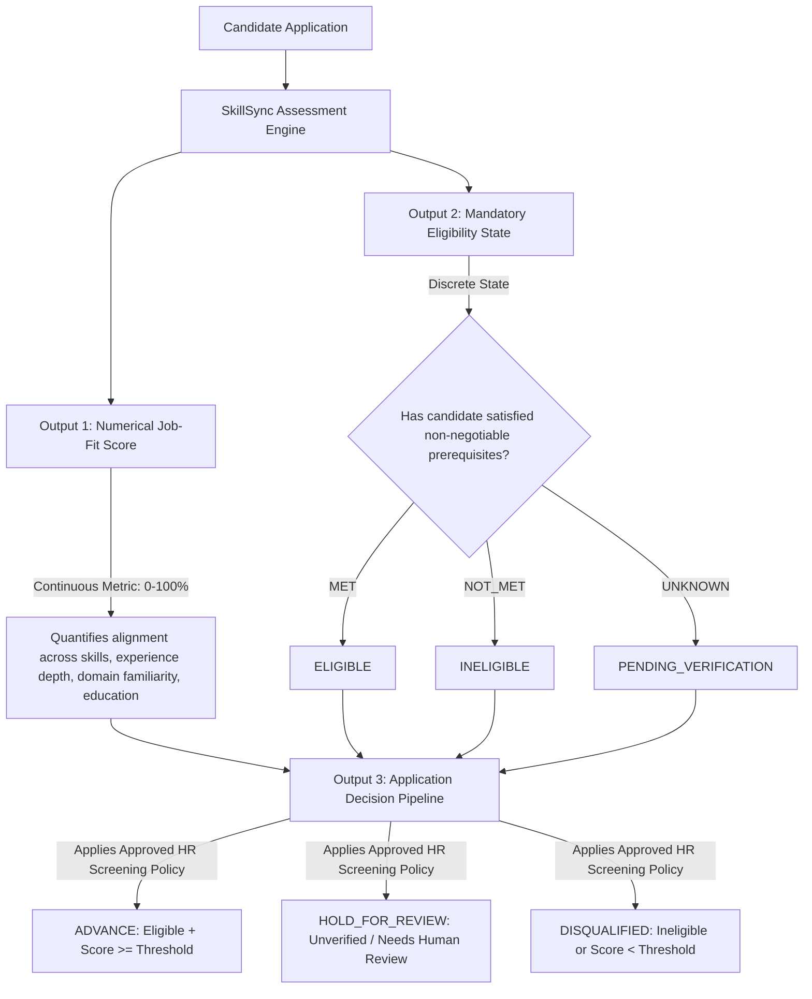

# RFC: Mandatory Qualification Gating & Eligibility Policy

**RFC Identifier:** RFC-2026-001  
**Status:** PROPOSED (Under HR Working Group Review — Not Production Policy)  
**Authors:** SkillSync Talent Science & Architecture Working Group  
**Target Release:** Post-Calibration (Phase 5 / Phase 6)  
**Related Migrations:** `20261004000000_fix_compute_and_save_job_match_canonical.sql`  

---

## 1. Executive Summary & Problem Statement

In SkillSync Phase 4, baseline evaluation against the standardized HR rubric revealed a significant architectural mismatch:
- **On Compliant Candidates**: The existing 6-factor algorithm matches human recruiter ratings with high fidelity ($\mathrm{MAE} \approx 4.43\%$, $100\%$ within $\pm 10\%$).
- **On Mandatory Qualification Failures**: Large divergence occurs ($\mathrm{MAE} \approx 26.67\%$).

### The Root Cause: Weighted Average Dilution
The server-authoritative database function `compute_and_save_job_match` calculates match percentages via dynamic weighted averaging:
$$\text{Score} = \text{round}\left( \frac{\sum_{i=1}^{6} W_i \times S_i}{\sum_{i=1}^{6} W_i} \right)$$

When an employer specifies a non-negotiable mandatory requirement (such as an active CPA license, a professional medical license, or a mandatory platform language), a candidate who demonstrably lacks that qualification still receives positive points from other factors (education, transferable skills, secondary competencies). As a result, the candidate may receive a match score of **55%–65%** ("Potential Match" / "Good Match"), whereas human recruiters treat the missing requirement as a hard gate and score the candidate at **$\le 35\%$** (`REJECT`).

This RFC proposes decoupling **Overall Job-Fit Alignment** from **Mandatory Eligibility**, introducing a 3-state qualification framework (`MET`, `NOT_MET`, `UNKNOWN`), and defining safe gating rules that prevent turning resume parsing failures into employment-screening errors.

---

## 2. Decoupling Job Fit from Mandatory Eligibility: The Three-Output Architecture

SkillSync must answer three related but conceptually distinct questions for every job requisition:

### The Three Conceptually Distinct Outputs:
1. **Output 1 — Numerical Job-Fit Score (Continuous 0–100%)**:
   Quantifies the objective alignment between the candidate's documented qualifications and the job requirements (technical skills, experience seniority, domain competencies). It is an honest measure of capability that should not be artificially suppressed.
2. **Output 2 — Mandatory Eligibility State (Discrete Category)**:
   Classifies candidate fulfillment of explicit, non-negotiable prerequisites into `ELIGIBLE`, `INELIGIBLE`, or `PENDING_VERIFICATION`.
3. **Output 3 — Application Decision (Policy Action)**:
   Applies the approved organizational screening policy combining eligibility and score thresholds to produce an operational workflow outcome: `ADVANCE`, `HOLD_FOR_REVIEW`, or `DISQUALIFIED`.

---

## 3. The Three Qualification States

For each designated mandatory requirement, SkillSync evaluates candidate evidence into one of three distinct states:

| Qualification State | Operational Meaning | Recommended Output 2 Status | User & Recruiter Explanation |
| :--- | :--- | :--- | :--- |
| **`MET`** | Documentary evidence in the resume or verified profile satisfies the requirement. | `ELIGIBLE` | *"Requirement satisfied: [Evidence details from resume]."* |
| **`NOT_MET`** | Reliable documentary evidence affirmatively establishes that the requirement is **not satisfied** (e.g. candidate has 8 months total experience for a 5-year senior role; or candidate explicitly notes lack of required license). | `INELIGIBLE` | *"Ineligible: Job mandates [Requirement Name]. Available records confirm this requirement is not met."* |
| **`UNKNOWN`** | The resume and profile omit mention of the qualification (**Absence of Evidence $\neq$ Evidence of Absence**). | `PENDING_VERIFICATION` | *"Pending Verification: [Requirement Name] is not mentioned in your resume. Candidate self-attestation or recruiter review requested."* |

---

## 4. Mandatory vs. Preferred Requirements Governance

A critical risk in algorithmic screening is **"requirement creep"**—where preferred skills or recruiter wish-lists become hidden disqualification rules.

### 4.1 Strict Criteria for Mandatory Designation
A requirement may be designated as **`MANDATORY`** only if:
1. **Regulatory / Licensing Mandate**: Required by law, government regulation, or industry compliance (e.g. CPA, Registered Nurse, Bar Admission, Security Clearance).
2. **Bona Fide Occupational Qualification (BFOQ)**: Absolutely essential to day-to-day operations (e.g. Native Swift for an iOS Lead with no cross-platform layer).
3. **Minimum Safety / Tenue Threshold**: Hard organizational boundary verified by hiring manager.

### 4.2 Non-Gating Preferred Qualifications
Skills designated as **`PREFERRED`** (e.g. *"GraphQL is a plus"*, *"Docker familiarity preferred"*):
- Award positive points within Factor 1 (`Required Skills`) or Factor 2 (`Transferable Skills`).
- **NEVER** cap overall scores.
- **NEVER** trigger `NOT_MET` or disqualify a candidate if absent.

---

## 5. Preventing Parsing Failures from Becoming Screening Errors

In automated screening, a resume parser may fail to recognize a certification due to unusual formatting, non-standard headings, or compressed fonts.

> [!CAUTION]
> If SkillSync treated missing extracted text as an automatic `NOT_MET`, a parsing bug would directly cause an unlawful or unfair employment rejection.

### The Parsing Safety Rule:
1. **Silence Triggers `UNKNOWN`, Never `NOT_MET`**:
   If a certification is not detected by `p08-skillRecognizer` or `p06-fieldExtractor`, the system status is strictly **`UNKNOWN`**.
2. **`NOT_MET` Requires Affirmative Disqualifying Evidence**:
   `NOT_MET` may be asserted only when:
   - The candidate's total career history is mathematically less than the required tenure (e.g., first job started in 2025 for a role requiring 5+ years).
   - The candidate explicitly selected "No" on a pre-application screening questionnaire.
   - An expired license date is detected in document text.
3. **Verification Workflow for Candidates**:
   When a profile receives an `UNKNOWN` status on a mandatory requirement, the UI displays an **"Upload Credential"** prompt, allowing the jobseeker to attach a certificate or attest to their qualification before employer review.

---

## 6. Unresolved Policy Decision: Score Capping vs. Conceptual Decoupling

A critical architectural and talent-policy question must be resolved by HR leadership prior to production implementation:

> **The Policy Question:**  
> When a candidate explicitly fails a valid mandatory requirement (`NOT_MET`), should SkillSync:
> - **Option A (Score Capping):** Artificially overwrite the candidate's numerical Job-Fit Score with a hard cap at $\le 35\%$ (`Skills Gap`)?
> - **Option B (Conceptual Decoupling — Recommended):** Preserve the honest, unpenalized numerical Job-Fit Score (e.g., $82\%$), while enforcing disqualification strictly via the **Mandatory Eligibility State** (`INELIGIBLE`) and **Application Decision** (`DISQUALIFIED`)?

### Comparative Analysis:

| Dimension | Option A: Hard Score Capping ($\le 35\%$) | Option B: 3-Output Decoupling (Recommended) |
| :--- | :--- | :--- |
| **Architectural Separation** | Conflates qualification scoring with screening policy. | Strict separation between scoring, eligibility, and decision. |
| **Research & Calibration Impact** | Corrupts benchmark metrics ($\mathrm{MAE}/\mathrm{RMSE}$ conflate algorithm calibration with hard gating). | Allows measuring continuous score accuracy independently from categorical eligibility accuracy. |
| **Recruiter Transparency** | Recruiter sees a low score but may not know if candidate lacked skills or just missed one license. | Recruiter sees high technical skills ($82\%$) alongside clear badge *"Ineligible: Missing State Bar License"*. |
| **Legal & Audit Defensibility** | Risky: masks underlying skill evaluation behind arbitrary score truncation. | Defensible: audit trail records genuine skill alignment and explicit statutory disqualification separately. |
| **Candidate Experience** | Demoralizing: candidate with 10 years experience sees a failing $35\%$ score without nuance. | Transparent: candidate sees strong qualification match with actionable note on missing prerequisite. |

### Current Resolution Status:
- The evaluation and simulation test harness supports **both models** (via `simulateProposedGating` for Option A and `resolveThreeOutputAssessment` for Option B).
- **Mandatory Approval Requirement**: Neither option will be deployed to production or encoded into database RPCs until HR, Talent Science, and Legal formally review and approve the preferred operational policy.

---

## 7. False-Positive and False-Negative Risk Analysis

| Error Type | Scenario | Consequence | Mitigation in RFC |
| :--- | :--- | :--- | :--- |
| **False Negative (Type I)** | Qualified candidate has license, but parser failed to extract it. | Unfair rejection of qualified applicant. | Classified as `UNKNOWN` rather than `NOT_MET`; human review triggered (`HOLD_FOR_REVIEW`). |
| **False Positive (Type II)** | Candidate lacks critical medical license, but weighted average gives 65% match. | Recruiter wastes time interviewing ineligible applicant. | `NOT_MET` status immediately sets `INELIGIBLE` and `DISQUALIFIED`. |
| **Requirement Creep** | Employer marks 15 preferred skills as mandatory. | Severe talent pipeline starvation. | Employer UI limits mandatory flags to verified credentials and core minimums. |

---

## 8. Auditability, Transparency, and Human Review Requirements

1. **Clear Explanations**: Every gating outcome must be accompanied by human-readable explanations citing specific requirements.
2. **Audit Logging**: Every transition to `NOT_MET` or `UNKNOWN` must be recorded in `audit_logs` with timestamps and evaluating parser version.
3. **Recruiter Override**: Recruiters must have the ability to manually verify and mark an `UNKNOWN` requirement as `MET` in the applicant review screen.

---

## 9. RFC Approval Workflow & Next Steps

This RFC is an **architectural proposal and readiness review document**. Prior to any database migration or RPC modification:
1. **HR & Legal Sign-Off**: Formally decide between Option A (Score Capping) and Option B (3-Output Decoupling).
2. **Recruiter Calibration Review**: Review gating definitions during the Stage 1 HR Pilot.
3. **Staging Validation**: Implement gating logic in an isolated test environment and validate across test cohorts.
4. **Formal Sign-Off**: Approval by Talent Science Working Group, Legal, and Lead Architect.

