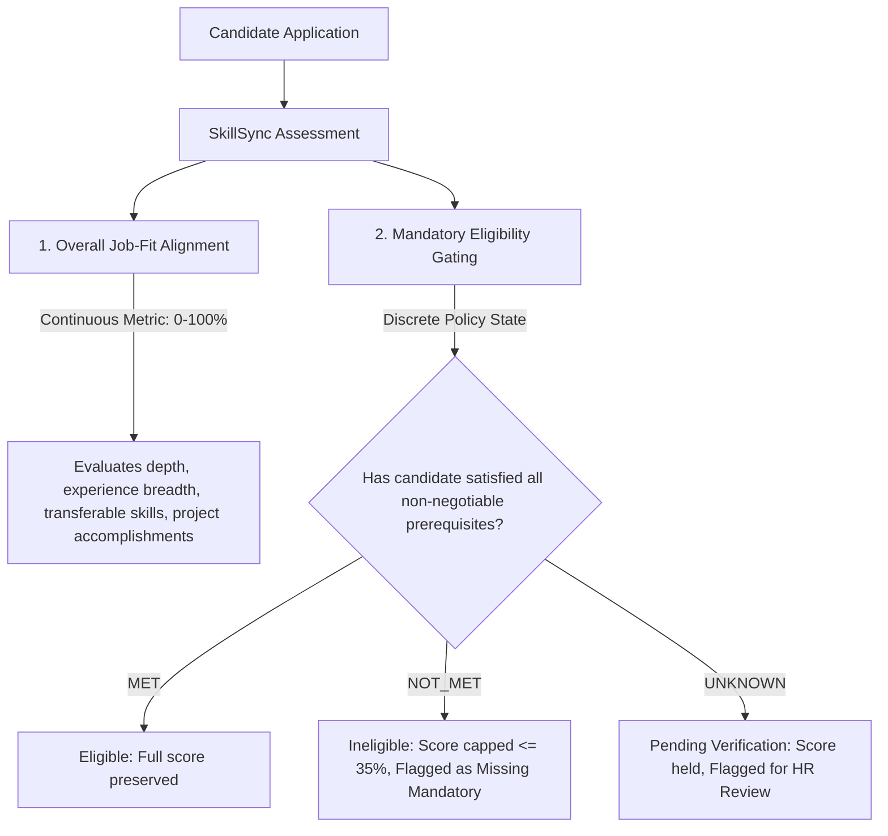

# RFC: Mandatory Qualification Gating & Eligibility Policy

**RFC Identifier:** RFC-2026-001  
**Status:** PROPOSED (Under HR Working Group Review — Not Production Policy)  
**Authors:** SkillSync Talent Science & Architecture Working Group  
**Target Release:** Post-Calibration (Phase 5 / Phase 6)  
**Related Migrations:** `20261004000000_fix_compute_and_save_job_match_canonical.sql`  

---

## 1. Executive Summary & Problem Statement

In SkillSync Phase 4, baseline evaluation against the standardized HR rubric revealed a significant architectural mismatch:
- **On Compliant Candidates**: The existing 6-factor algorithm matches human recruiter ratings with high fidelity ($\mathrm{MAE} \approx 4.43\%$, $100\%$ within $\pm 10\%$).
- **On Mandatory Qualification Failures**: Large divergence occurs ($\mathrm{MAE} \approx 26.67\%$).

### The Root Cause: Weighted Average Dilution
The server-authoritative database function `compute_and_save_job_match` calculates match percentages via dynamic weighted averaging:
$$\text{Score} = \text{round}\left( \frac{\sum_{i=1}^{6} W_i \times S_i}{\sum_{i=1}^{6} W_i} \right)$$

When an employer specifies a non-negotiable mandatory requirement (such as an active CPA license, a professional medical license, or a mandatory platform language), a candidate who demonstrably lacks that qualification still receives positive points from other factors (education, transferable skills, secondary competencies). As a result, the candidate may receive a match score of **55%–65%** ("Potential Match" / "Good Match"), whereas human recruiters treat the missing requirement as a hard gate and score the candidate at **$\le 35\%$** (`REJECT`).

This RFC proposes decoupling **Overall Job-Fit Alignment** from **Mandatory Eligibility**, introducing a 3-state qualification framework (`MET`, `NOT_MET`, `UNKNOWN`), and defining safe gating rules that prevent turning resume parsing failures into employment-screening errors.

---

## 2. Decoupling Job Fit from Mandatory Eligibility

SkillSync must answer two related but distinct questions for every job requisition:

1. **Overall Job-Fit Alignment (Continuous 0–100%)**:
   Measures the candidate's holistic alignment across required technical skills, transferable problem-solving, education, work experience, and domain achievements.
2. **Mandatory Eligibility (Discrete Status)**:
   Determines whether the candidate satisfies every legal, regulatory, or operational non-negotiable condition required to perform the job.

---

## 3. The Three Qualification States

For each designated mandatory requirement, SkillSync must evaluate candidate evidence into one of three distinct states:

| Qualification State | Operational Meaning | System Handling & Score Impact | User Explanation |
| :--- | :--- | :--- | :--- |
| **`MET`** | Documentary evidence in the resume or verified profile satisfies the requirement. | Normal weighted scoring continues without capping. | *"Requirement satisfied: [Evidence details from resume]."* |
| **`NOT_MET`** | Reliable documentary evidence affirmatively establishes that the requirement is **not satisfied** (e.g. candidate has 8 months total experience for a 5-year senior role; or candidate explicitly notes lack of required certification). | Overall score is capped at **$\le 35\%$** (`Skills Gap`). Status set to `Ineligible`. | *"Ineligible: Job mandates [Requirement Name]. Available records indicate this requirement is not met."* |
| **`UNKNOWN`** | The resume and profile omit mention of the qualification (**Absence of Evidence $\neq$ Evidence of Absence**). | **NO automatic rejection or score penalty.** Score is preserved with an `Unverified Mandatory` flag. Requires human recruiter review or candidate self-attestation. | *"Pending Verification: [Requirement Name] is not mentioned in your resume. You may submit verification or contact the hiring team."* |

---

## 4. Mandatory vs. Preferred Requirements Governance

A critical risk in algorithmic screening is **"requirement creep"**—where preferred skills or recruiter wish-lists become hidden disqualification rules.

### 4.1 Strict Criteria for Mandatory Designation
A requirement may be designated as **`MANDATORY`** only if:
1. **Regulatory / Licensing Mandate**: Required by law, government regulation, or industry compliance (e.g. CPA, Registered Nurse, Bar Admission, Security Clearance).
2. **Bona Fide Occupational Qualification (BFOQ)**: Absolutely essential to day-to-day operations (e.g. Native Swift for an iOS Lead with no cross-platform layer).
3. **Minimum Safety / Tenue Threshold**: Hard organizational boundary verified by hiring manager.

### 4.2 Non-Gating Preferred Qualifications
Skills designated as **`PREFERRED`** (e.g. *"GraphQL is a plus"*, *"Docker familiarity preferred"*):
- Award positive points within Factor 1 (`Required Skills`) or Factor 2 (`Transferable Skills`).
- **NEVER** cap overall scores.
- **NEVER** trigger `NOT_MET` or disqualify a candidate if absent.

---

## 5. Preventing Parsing Failures from Becoming Screening Errors

In automated screening, a resume parser may fail to recognize a certification due to unusual formatting, non-standard headings, or compressed fonts.

> [!CAUTION]
> If SkillSync treated missing extracted text as an automatic `NOT_MET`, a parsing bug would directly cause an unlawful or unfair employment rejection.

### The Parsing Safety Rule:
1. **Silence Triggers `UNKNOWN`, Never `NOT_MET`**:
   If a certification is not detected by `p08-skillRecognizer` or `p06-fieldExtractor`, the system status is strictly **`UNKNOWN`**.
2. **`NOT_MET` Requires Affirmative Disqualifying Evidence**:
   `NOT_MET` may be asserted only when:
   - The candidate's total career history is mathematically less than the required tenure (e.g., first job started in 2025 for a role requiring 5+ years).
   - The candidate explicitly selected "No" on a pre-application screening questionnaire.
   - An expired license date is detected in document text.
3. **Verification Workflow for Candidates**:
   When a profile receives an `UNKNOWN` status on a mandatory requirement, the UI displays an **"Upload Credential"** prompt, allowing the jobseeker to attach a certificate or attest to their qualification before employer review.

---

## 6. Interaction with Existing Score Tiers

SkillSync's existing UI renders matches in 4 tiers:
- **Strong Match**: $\ge 80\%$
- **Good Match**: $60\% - 79\%$
- **Potential Match**: $40\% - 59\%$
- **Skills Gap**: $< 40\%$

### Proposed Gating Policy Integration:
1. **If all mandatory items are `MET`**:
   The calculated weighted score displays normally in its respective tier.
2. **If any mandatory item is `NOT_MET`**:
   The displayed match score is capped at $\min(\text{RawScore}, 35\%)$, forcing placement in the `Skills Gap` tier. A badge **"Mandatory Requirement Unmet"** displays alongside the specific item name.
3. **If any mandatory item is `UNKNOWN`**:
   The calculated match score is displayed alongside a yellow **"Verification Required"** pill. The candidate is NOT moved to `Skills Gap`.

---

## 7. False-Positive and False-Negative Risk Analysis

| Error Type | Scenario | Consequence | Mitigation in RFC |
| :--- | :--- | :--- | :--- |
| **False Negative (Type I)** | Qualified candidate has license, but parser failed to extract it. | Unfair rejection of qualified applicant. | Classified as `UNKNOWN` rather than `NOT_MET`; human review triggered. |
| **False Positive (Type II)** | Candidate lacks critical medical license, but weighted average gives 65% match. | Recruiter wastes time interviewing ineligible applicant. | `NOT_MET` hard cap ($\le 35\%$) immediately flags ineligibility. |
| **Requirement Creep** | Employer marks 15 preferred skills as mandatory. | Severe talent pipeline starvation. | Employer UI limits mandatory flags to verified credentials and core minimums. |

---

## 8. Auditability, Transparency, and Human Review Requirements

1. **Clear Explanations**: Every gating outcome must be accompanied by human-readable explanations citing specific requirements.
2. **Audit Logging**: Every transition to `NOT_MET` or `UNKNOWN` must be recorded in `audit_logs` with timestamps and evaluating parser version.
3. **Recruiter Override**: Recruiters must have the ability to manually verify and mark an `UNKNOWN` requirement as `MET` in the applicant review screen.

---

## 9. RFC Approval Workflow & Next Steps

This RFC is an **architectural proposal**. Prior to any database migration or RPC modification:
1. **Recruiter Calibration Review**: Review gating definitions during the Stage 1 HR Pilot.
2. **Staging Validation**: Implement gating logic in an isolated test environment and validate across test cohorts.
3. **Formal Sign-Off**: Approval by Talent Science Working Group and Lead Architect.
